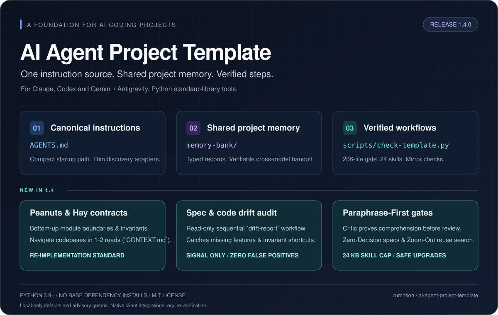

<p align="center">
  
</p>

<p align="center">
  <a href="https://github.com/rumotion/ai-agent-project-template/generate"></a>
  <a href="https://github.com/rumotion/ai-agent-project-template/releases"></a>
  <a href="LICENSE"></a>
</p>

# AI Agent Project Template

A starter repository and upgrade framework for software projects built with AI
coding agents (Claude Code, OpenAI Codex, Google Gemini / Antigravity, Cline,
Cursor, Copilot, Windsurf, and Aider). Keep instructions in one canonical file,
carry verified project context across sessions and models, and upgrade existing
projects safely with dependency-free Python standard-library tooling.

[How to use](#quick-start) | [Upgrade existing projects](#upgrade-an-existing-project) |
[What is included](#what-is-included) | [What changed in v1.4](#what-changed-in-v14) |
[Verification](#verification) | [Documentation](#documentation) |
[Releases](https://github.com/rumotion/ai-agent-project-template/releases)

[](https://github.com/rumotion/ai-agent-project-template/actions/workflows/validate.yml)
[](scripts/README.md)
[](AGENTS.md)

## Quick start

**Requirements:** Python 3.9 or newer and Git. Template scripts use the Python
standard library only and need no package installation.

### 1. Create a new local project

From a local clone of this template, bootstrap a clean project in a separate
directory:

```bash
python scripts/new-project.py ../my-project --name "My Project"
cd ../my-project
python scripts/init-fast.py
```

What this does automatically:
- Copies only tracked framework files (no template scratch or logs).
- Resets `memory-bank/`, `README.md`, `VERSION`, and `CHANGELOG.md` to clean project stubs.
- Initializes a fresh local Git repository with no upstream remote and installs a local-only `pre-push` safety hook.

Open `../my-project` in your AI coding agent and start the session with:

```text
FAST_INIT (default mode per AGENTS.md).
```

Then describe what you want to build. Unknown stack details stay `TBD` until you
decide them. Full guide: [Start a new project](docs/start-new-project.md).

### 2. Start from GitHub ("Use this template")

Select **[Use this template](https://github.com/rumotion/ai-agent-project-template/generate)**
on GitHub to create a new repository, clone it locally, and run:

```bash
python scripts/init-fast.py
```

If you cloned this template repository directly instead of generating from it,
`init-fast.py` automatically detaches the inherited template `origin` so you
never push private code back to the template.

### 3. Daily multi-model workflow

- **Start a session:** the agent reads `AGENTS.md` and `memory-bank/startup.md` (`FAST_INIT`, ~1,900 tokens).
- **Pause or switch models (Claude <-> Codex <-> Gemini/Antigravity):** ask the agent to run the `handoff` workflow, or run:
  ```bash
  python scripts/continuity.py checkpoint --task-id <task-id> --client <client>
  ```
- **Resume work:** the next model reads `memory-bank/handoff.md` and runs:
  ```bash
  python scripts/continuity.py doctor --mode legacy
  python scripts/tasks.py list
  ```

## Upgrade an existing project

You can install or update this AI agent framework in **any existing project**
(whether it was created from an older version of this template or started from
scratch) without losing your application code, custom domain rules in
`AGENTS.md`, custom skills, or `memory-bank/` history.

### Option A: Ask your AI agent (fastest)

Open your existing project in Claude Code, Codex, or Antigravity and paste:

```text
Upgrade this project's AI framework from
https://github.com/rumotion/ai-agent-project-template using its latest upgrade
workflow. Preserve application code, tests, settings, custom rules, skills and
project memory. Preview changes, resolve conflicts and run the project's checks.
Do not push or deploy.
```

**Even faster on future updates:** the first upgrade saves the template URL and
installed file hashes in `.template-upstream.json`. Next time, just tell your agent:

```text
Update this project from its saved AI template source and verify the result locally.
```

### Option B: Run the CLI upgrader directly

From a local checkout of this template (or inside a project that already has
`scripts/upgrade-target.py`):

```bash
# 1. Preview changes safely (writes zero files)
python scripts/upgrade-target.py --target ../existing-project --dry-run

# 2. Apply the upgrade (creates an external backup and JSON report automatically)
python scripts/upgrade-target.py --target ../existing-project
```

You can also upgrade directly from GitHub or GitLab with a pinned ref:

```bash
python scripts/upgrade-target.py --target ../existing-project \
  --source https://github.com/rumotion/ai-agent-project-template \
  --ref v1.4.0 --dry-run
```

If you modified a framework file locally, the upgrader marks it as a `conflict`
and preserves your file untouched so you or your agent can merge it selectively.
Full details: [Upgrade an existing project](docs/upgrade-existing-project.md).

## What is included

| Component | Purpose |
|---|---|
| [AGENTS.md](AGENTS.md) | Canonical agent instructions, startup rules, and repository boundaries |
| [Memory Bank](memory-bank/00-index.md) | Indexed project facts and a handoff for the next session or model |
| [Peanuts & Hay contracts](docs/peanuts-and-hay.md) | Bottom-up module boundaries (`README.md` or `CONTEXT.md`) under the Re-Implementation Standard |
| [Context compiler](docs/context-compiler.md) | Typed records compiled into validated, bounded context |
| [Continuity & task ledger](docs/continuity.md) | Private checkpoints, resume doctor, and durable task state (`scripts/tasks.py`) |
| [Advisor model routing](docs/adaptive-model-routing.md) | Offline R1 escalation policy (`scripts/routing_policy.py`) for writer + senior advisor |
| [Portable subagent contracts](docs/subagent-contract.md) | Task/result schemas with path scopes, pairing, and report limits |
| [Workflows](workflows/) | Planning, implementation, debugging, review, bootstrap-context, drift-report, upgrade, and handoff |
| [24 skills and workflow entry points](.agents/skills/) | Canonical skills (24 KB load ceiling) with tracked Claude/Cline discovery mirrors |
| [Shared hooks](docs/hooks.md) | Advisory shell/write guards, metadata logging, and lifecycle context |
| [Project tools](scripts/README.md) | Creation, upgrades, initialization, validation, and adapter generation |
| [GitHub Actions](.github/workflows/validate.yml) | Windows/Linux validation on Python 3.9 and current Python |

Instruction/discovery files cover Claude, Gemini, Codex, Cline, Roo Code, Cursor,
Copilot, Windsurf, Aider, and related editor integrations. A discovery file does
not establish that every client consumes hook events. The
[capability inventory](schemas/adapter-capabilities.json) distinguishes candidate
mappings from missing live-client evidence.

## What changed in v1.4

- **Bottom-up module context contracts (`docs/peanuts-and-hay.md`, `workflows/bootstrap-context.md`):**
  adapted from Google's Elephant-Goldfish Model (EGM), leaf component contracts
  (**Peanuts**: `Overview`, `Interface`, `Invariants`, `Side Effects`,
  `Verification`) and subsystem blueprints (**Hay**) let fresh sessions navigate
  module boundaries in 1-2 file reads without inflating `FAST_INIT`. Supports
  both `README.md` and `CONTEXT.md` modes with a mandatory `> 15` directory gate.
- **Read-only spec and contract drift auditing (`workflows/drift-report.md`):**
  sequentially audits specifications, `Peanuts & Hay` module contracts, and
  Memory Bank architecture docs against current source code across four categories
  (`Missing Features`, `Incomplete Models`, `Logic Shortcuts`, `Architectural
  Divergence`), verified in a two-model (Claude + Codex) blind drift simulation.
- **Paraphrase-First, Zoom-Out, Zero-Decision, and Contradiction gates:**
  reviewers (`docs/reviewer-role.md`, `workflows/critic-review.md`) must emit a
  `paraphrase:` comprehension summary before findings and check for codebase reuse
  (`Zoom-Out`); specs/plans enforce the **Zero-Decision Rule**; the cognitive
  harness (`.agents/rules/30-cognitive-harness.md`) adds a **Contradiction Gate**.
- **24,000-byte skill load cap & full `scripts/README.md` Peanuts contract:**
  `scripts/check-template.py` enforces `SKILL_MAX_BYTES = 24_000` across all 24
  skills, validates the `paraphrase:` reviewer marker, and checks **206 required
  files** across 10 adapters and 3 skill discovery trees.

Release: [v1.4.0 - Elephant-Goldfish context contracts, drift auditing, and Paraphrase-First review gates](https://github.com/rumotion/ai-agent-project-template/releases/tag/v1.4.0).

### Earlier improvements in v1.3

- **Verifiable context continuity:** `scripts/continuity.py` adds private
  checkpoints, strict resume diagnostics (`doctor`) and visible redacted hook
  failure logs. `scripts/ctx.py` captures reviewed durable records, protects
  required IDs and scales to 1,000 archived records within the startup ceiling.
- **Durable task ledger and parent acceptance:** `scripts/tasks.py` tracks
  task attempts, revisions, dependency gates and file-scope inventories. Worker
  submissions stay separate from parent acceptance. `scripts/task_metrics.py`
  records ordinary task progress and token counters with quota pacing OFF.
- **Offline advisor model routing (R1):** `scripts/routing_policy.py` implements
  deterministic escalation between a fast implementation model and a read-only
  senior advisor for material plans, completion checks and repeated logic errors.
  Review receipts bind task revision, attempt, artifact hash and error events.
- **Smaller startup and native hook repairs:** compacted `memory-bank/00-index.md`
  from 1,534 to 619 characters (`FAST_INIT` ~7,710/9,500 chars). Fixed
  Antigravity CWD-independent hook dispatch and `write_file`/`Path` aliases,
  Codex Windows PowerShell hook execution, and Windows `core.longpaths` setup.
- **Verification:** full validation now checks **193 required files**, 10
  instruction adapters, 17 context budgets, 22 skills across 3 trees, and 15
  hardening/recovery suites. Scoped native evidence is recorded in
  [docs/recovery-pilot.md](docs/recovery-pilot.md).

Release: [v1.3.1 - Verifiable context continuity and advisor routing](https://github.com/rumotion/ai-agent-project-template/releases/tag/v1.3.1).

### Earlier improvements in v1.2

- **Upgrade existing projects:** point your agent at the current template on
  GitHub or GitLab, even if the project has no upgrade skill installed yet.
- **Preserve customizations:** installed-file hashes and optional legacy-release
  baselines identify safe updates. Unknown or locally edited files stay intact
  for a scoped agent merge. Existing project memory and active settings are kept.
- **Preview and recover:** commit SHA pins keep preview and apply on the same
  source. External backups and JSON reports record each apply; ordinary write
  failures roll back completed file changes.
- **Repeat with a short prompt:** the first remote upgrade remembers its source.
  Later requests can use the saved template URL.
- **Verification:** 23 upgrade scenarios cover preservation, retired custom
  helpers, local Git transport, source pins, rollback and Windows junctions.
  Application checks still determine compatibility in each project.

Read [usage pacing](docs/usage-pacing.md) for optional confirmed quota pacing
commands, state/telemetry formats and stop conditions. Previous releases:
[v1.2.1 - Upgrade existing projects](https://github.com/rumotion/ai-agent-project-template/releases/tag/v1.2.1)
| [v1.1.1 - Completion-first agent pacing](https://github.com/rumotion/ai-agent-project-template/releases/tag/v1.1.1).

## Core verification features

- **Context integrity:** reject invalid or oversized records; preserve complete
  bodies and fail explicitly instead of returning partial context.
- **Compiled startup:** Claude's SessionStart hook uses typed context records,
  with durable facts before changing status.
- **Scoped delegation:** paired task/result schemas, path ownership checks,
  forbidden paths and bounded UTF-8 reports.
- **Local push protection:** a shared installer preserves custom hooks and
  blocks ordinary accidental pushes. Publishing requires explicit authorization.
- **Reproducible adapters:** generated workflow/skill mirrors with drift checks.
- **Adversarial regressions:** context, contracts, shell guards and installer
  behavior are exercised by the dependency-free validator.

Details: [Changelog](CHANGELOG.md) |
[Implementation and verification](docs/audits/second-order/implementation.md).

## How project memory works

```text
AGENTS.md                 Canonical instructions
  +-- startup.md          Small current snapshot
  +-- 00-index.md         Select only relevant context
  +-- handoff.md          Where the previous session stopped
  +-- records/            Typed durable project records
        +-- ctx.py        Validated context: durable prefix, changing status
```

The startup path has a **9,500-character ceiling**, with an 8,500-character
advisory target. Token estimates use characters divided by four; they are not
provider measurements. Stable prefix bytes make caching experiments possible,
but this release claims no measured cache hit rate or token savings.

Reviewed durable records can be captured with `scripts/ctx.py record` and
retrieved by ID. For recovery, run `scripts/continuity.py doctor --mode legacy`
and list every page of `scripts/tasks.py list`. Private checkpoints/task state
live outside Git; worker submission and parent acceptance remain separate.
See the [continuity guide](docs/continuity.md), [task ledger](docs/task-ledger.md)
and [dated recovery evidence](docs/recovery-pilot.md). The current implementation
status and primary-source research are in [the workplan](docs/continuity-workplan.md).

## Verification

```bash
python scripts/check-template.py --fast
python scripts/check-template.py
python scripts/benchmark-context.py --self-test
python scripts/gen-adapters.py --check
```

Full validation checks the 206-file manifest, 10 instruction adapters, 17 context
budgets, schemas, mirrors, context integrity, hook fixtures, and the 15 hardening
and recovery suites. [Testing guide](docs/testing.md) documents the individual checks.

After changing canonical workflows or skills:

```bash
python scripts/gen-adapters.py --write
python scripts/gen-adapters.py --check
```

Keep the generated discovery files tracked so a fresh clone works immediately.

## Safety and limits

Projects are local-only by default. The pre-push hook prevents ordinary
accidental pushes when installed and enabled. Shell guards are advisory and
synthetic fixtures verify their decisions, not actual native-client consumption.
A process able to change hooks, use alternate Git plumbing, or run another
network client can bypass them.

```bash
python scripts/boundary.py inspect --client codex --json
```

This template supplies no hostile-process sandbox or supervisor-owned transaction
ledger. External egress/protected-path isolation, native-client verification,
provider cache measurements, and Cline rule slimming remain future work.
MCP integrations are opt-in; no active MCP configuration ships.

Keep credentials outside Git. Ignored files are still local files, and
`.gitignore` cannot remove content from existing commit history.

## Documentation

| Goal | Guide |
|---|---|
| Create a project | [Start a new project](docs/start-new-project.md) |
| Update a project | [Upgrade guide](docs/upgrade-existing-project.md) |
| Bootstrap module contracts | [Peanuts & Hay guide](docs/peanuts-and-hay.md), [Bootstrap workflow](workflows/bootstrap-context.md) |
| Audit spec-to-code drift | [Drift report workflow](workflows/drift-report.md) |
| Choose an integration | [Compatibility](docs/agent-compatibility.md) | [Per-tool setup](docs/per-tool-setup.md) |
| Resume with another model | [Handoff workflow](workflows/handoff.md) |
| Understand the hooks | [Hook behavior and limitations](docs/hooks.md) |
| Validate worker reports | [Subagent contract](docs/subagent-contract.md) |
| Pace approved quota use | [Optional usage pacing](docs/usage-pacing.md) |
| Assess cross-client mail | [Local mail assessment](docs/local-agent-mail.md) |
| Review current AI tooling changes | [October 2026 review](docs/ai-market-review-2026-10.md) |
| Inspect context | [Context compiler](docs/context-compiler.md) |
| Route writer and advisor models | [Adaptive model routing](docs/adaptive-model-routing.md) |
| Measure ordinary task progress/cost | [Task measurements, pacing OFF](docs/task-measurements.md) |
| Close feedback and product acceptance | [Feedback trace](docs/feedback-closure.md), [environment matrix](docs/product-acceptance.md) |
| Publish a release | [Release checklist](docs/releasing.md) |
| Review the public surface | [Public release review](docs/public-release-review.md) |

## Contributing and license

Small, verified changes are welcome. Read [CONTRIBUTING.md](CONTRIBUTING.md),
include reproduction steps or validation evidence, and update the relevant docs.
Report template security concerns through [SECURITY.md](SECURITY.md).

Released under the [MIT license](LICENSE). Copyright (c) 2026 rumotion.
