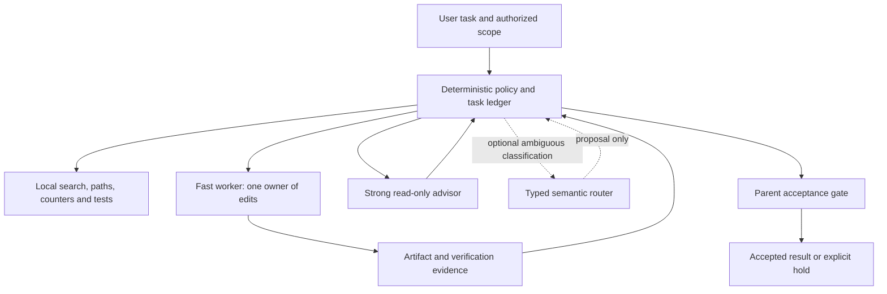

# Adaptive model routing: feasibility and proposed architecture

Research date: 2026-11-07. Status: assessed; no automatic router activated.
The R1 offline advisory policy is implemented; native dispatch remains separate.
This extends [model routing](../memory-bank/model-routing.md) and the conditional
runtime work. It does not change the selected model, install clients or send
project content to a new provider. Provider features and installed versions are
separate evidence.

Local feasibility follow-up: CLI 1.5.2 ran one Flash Medium writer and one Argon
High tool-free advisor through a scripted completion checkpoint; six parent
tests and the advisor's artifact hash passed. Settings stayed unchanged. This
is a small experiment, not implementation of the proposed routing policy or a
cost comparison. Native IDE file-tool/new-conversation observations also passed.
Exact models, versions, failures and limits: [pilot receipts](recovery-pilot.md).

## What the supplied post establishes

Anthropic documents a native advisor, including Haiku/Opus pairings. Consultation
is model-driven; an instruction naming three checkpoints cannot force it. The
advisor receives the full conversation and adds usage. A cheaper complete task
is plausible, not measured here. Aliases advance with releases; resolve actual
IDs. Haiku 5.5 requires Claude Code 2.1.293 or later; the installed 2.1.116 does
not establish support. The feature uses Anthropic's API transport, including
supported subscription accounts; it is not a universal cross-provider tool.
See [Claude advisor](https://code.claude.com/docs/en/advisor).

Jev is a probabilistic typed-decision model, not a deterministic policy engine
or code generator. It can classify ambiguous states; confidence is not proof
of correctness or permission. [TypeSafe System One](https://docs.typesafe.ai/concepts/system-one)
describes that boundary. File existence, path containment, counters, budgets,
revisions and permission checks belong in code. The provider itself advises
keeping arithmetic and date comparisons outside the model and filtering
irrelevant state: [limitations](https://docs.typesafe.ai/model-jaggedness).
The [API](https://docs.typesafe.ai/api/system-one) is a separate authenticated
service; it is not installed or called by this template.

The [independent Jev engineering kit](https://github.com/codejunkie99/jev-engineering)
is a proposed framework, not Anthropic documentation or evidence that this
workstation routes decisions in milliseconds. Its synthetic checks do not
establish semantic accuracy. No latency or savings figure is adopted here.

## Platform feasibility

| Surface | Documented mechanism | Practical design and remaining evidence |
|---|---|---|
| Claude Code CLI | Native advisor; custom subagents with explicit models | Prefer the native advisor for convenience when the installed version/account supports it. Use a separate bounded reviewer if full-transcript consultation is unsuitable. An instruction remains advisory. |
| Claude inside VS Code | The CLI can run in the integrated terminal; native extension capabilities are version-dependent | Terminal use works without replacing the editor. Verify the extension's exact advisor/model controls before claiming equivalent behavior. |
| Codex CLI / custom client | Custom agents accept model/effort settings; App Server supports per-turn model selection | Use a read-only advisor child, or separate advisor thread and resume the worker after a checked result. Verify the actual runtime model; names alone are not evidence. |
| Codex IDE surface | Subagent activity is documented across the app, CLI and IDE | Prefer native roles when exposed. A repository cannot grant a missing model-selection parameter or control an unrelated active session. |
| Gemini CLI | Model routing and per-subagent model configuration | A Flash-class worker with a stronger reviewer is feasible. Verify the installed 0.52.0 route separately; current documentation is not a native receipt. |
| Antigravity App / IDE | Custom subagents document model tiers `inherit`, `flash`, `pro` | This can provide a fast worker and stronger advisor without replacing the main chat model. Tier names are not a promise of any exact Gemini version. Native IDE file tools/new conversation passed with UI-selected Argon High; native subagent routing and standalone App remain unverified. |
| Antigravity CLI / SDK | Session model flags, subagents, SDK and ACP | A CLI/SDK coordinator can select separate roles. ACP lets compatible editors host the agent; it does not automatically implement this routing policy. The CLI currently reports 1.5.2; historical 1.1.8 receipts remain historical. |
| One workflow across vendors | Separate provider adapters | Feasible through an external coordinator. Subscription authentication, model availability and data boundaries remain per-provider. No subscription is assumed interchangeable with API credit. |

Sources: [Claude subagents](https://code.claude.com/docs/en/sub-agents),
[Codex subagents](https://learn.chatgpt.com/docs/agent-configuration/subagents),
[Codex App Server](https://learn.chatgpt.com/docs/app-server),
[Gemini subagents](https://geminicli.com/docs/core/subagents/),
[Gemini routing](https://geminicli.com/docs/cli/model-routing/),
[Antigravity subagents](https://antigravity.google/docs/subagents),
[SDK subagents](https://antigravity.google/docs/sdk/subagents/), and
[ACP](https://antigravity.google/docs/cli/acp/).
Google also documents [Gemini CLI migration](https://antigravity.google/docs/cli/gcli-migration/);
migration is not performed by this assessment.

## Recommended design — engineering proposal

Use capability roles resolved against an observed catalog, not hardcoded claims
that one family is always cheap or strong. There are three deployment levels:

1. Native roles/advisor within one supported client. Smallest initial experiment.
2. A local coordinator invoking installed CLIs with explicit session settings.
   The IDE remains the editor; execution appears in its terminal or an MCP tool.
3. A thin editor extension or ACP client over the same coordinator. This provides
   an integrated panel without scripting the existing model-picker UI.



The coordinator owns task revision, attempt, artifact fingerprint, authorization,
route, requested/observed model and evidence. Reuse `tasks.py`, portable envelopes,
`continuity.py`, `task_metrics.py` and the existing context compiler. These helpers
do not currently launch workers or enforce a native stop. Implement those missing
capabilities explicitly before claiming a supervisor.

The fast model may request escalation. It cannot be its only trigger. Coordinator
rules require review at a consequential plan checkpoint, after two failures with
the same normalized non-transient signature, and before accepting material work.
Do not consult a model for a missing file or repeat a denied action. Transient
service failures retain bounded backoff; missing permissions require a hold.

Search and call-site lookup should use local tools first. Three always-running
search/grep/docs agents duplicate overhead on small tasks. Create a bounded
read-only helper only when its isolated work is justified. Keep one writer and
one advisor initially; no recursive delegation or automatic fleet expansion.

The advisor receives the frozen objective, relevant facts, diff, errors, test
results and source hashes. Return a bounded structured recommendation with
findings and required checks. A model's assertion that tests passed or another
model was called is not an execution receipt. Reject stale results; unavailable
required advice leaves acceptance pending. Advice never executes commands.

Built-in Claude advisor necessarily reads the transcript; this differs from
the bounded external-advisor packet. Its consultations are also distinct from
an isolated artifact-only critic required by this repository's review workflow.

For Jev, an optional adapter could ask which predefined route fits an ambiguous
task. Validate the response, include an abstain path and calibrate on held-out
project cases. A timeout, malformed result or uncertain classification retains
the configured safe route or a hold. The semantic router never selects arbitrary
commands, bypasses checks, authorizes external actions or replaces final tests.

Cross-provider advice is a separate transmission of project context. Use one
provider first, minimize packets, and preserve each project's existing data
boundary. New service use, API expenditure or dependency installation is outside
this assessment. Do not embed credentials or rewrite global model defaults.

## Bounded implementation sequence

| Package | Concrete deliverable | Acceptance gate |
|---|---|---|
| R0: assessment | This matrix and native/local distinction | Official sources, installed versions and unresolved entitlement are recorded |
| R1: offline policy | Pure deterministic route selection with disabled provider adapters | Tests cover repeated-error grouping, transient failures, denied actions, stale evidence, unknown model, unavailable advisor and bounded retries; no model/network calls |
| R2: one native pilot | One fast worker plus one read-only advisor through a supported installed route | Observe both exact models, one consultation, complete task tests, unchanged global settings, no duplicate writer; preserve failure evidence |
| R3: measured adoption | Matched strong-only, fast-only and fast-plus-advisor tasks | Compare complete accepted tasks including router/advisor reads, repair turns, failures, latency and available usage; no invented zero usage |
| R4: additional clients | One separately tested adapter per actual surface | Same acceptance contract, per-surface receipts and explicit unsupported cases |
| R5: optional Jev / concurrency | Separately scoped adapter or supervisor | Semantic calibration/data review for Jev; ownership, stop acknowledgement and late-result tests for concurrency |

The existing five task types with three alternating pairs provide a starting
pilot when a bounded budget is available. For routing, compare model-specific
cost or quota separately from raw token counts: cheaper tokens do not imply fewer
tokens. Preserve the existing >=10% token policy only for token-saving adoption;
do not relabel it as a universal financial rule. Cache and advisor usage must not
be counted twice. Until matched data exists, verdict: `INSUFFICIENT_EVIDENCE`.

Rollback is per-project: stop the coordinator, reconcile unfinished attempts,
disable the opt-in route and resume the existing single-model/manual path. Never
reassign a running writer merely because its heartbeat or result is missing.

## R1 offline interface

Run `python scripts/routing_policy.py observation.json` or import `decide`.
Run `python scripts/verify-routing-policy.py` for the 24 behavioral checks, also
included in the full template gate. No client hook, MCP service or provider is
activated. The helper never imports a native client, runs a command, writes state
or selects an actual model ID. It advises a coordinator that already owns the
task, permissions, metrics, evidence and native lifecycle.

Minimal observation (replace the synthetic fingerprint with the current one):

```json
{
  "schema_version": 1,
  "task_id": "example", "task_revision": 1, "attempt_id": "attempt-one",
  "artifact_sha256": "aaaaaaaaaaaaaaaaaaaaaaaaaaaaaaaaaaaaaaaaaaaaaaaaaaaaaaaaaaaaaaaa",
  "checkpoint": "routine", "material": true,
  "permission": "allowed", "evidence_current": true,
  "model_available": true, "advisor_available": true,
  "budget": "unknown", "hard_budget": false,
  "verification": "unknown", "retry_count": 0, "errors": []
}
```

All fields above are required. Only optional `advisor_requested` (boolean) and
`advisor_receipts` (at most eight objects) are additionally accepted. Checkpoints
are `routine|plan|completion`; permission `allowed|denied|unknown`; budget
`ready|hold|unknown`; verification `passed|failed|unknown`. Use task-metrics advice
for the budget declaration; no second usage parser or spending controller exists.
Unknown budget is allowed only without a declared hard budget.

`errors` is an ordered list of at most 32 events. Each has `task_id`, positive
integer `task_revision`, `attempt_id`, unique `event_id`, `kind` (`logic`,
`transient` or `permission`) and a 64-character SHA-256 `signature` of the
coordinator-normalized failure. Never include raw commands, logs or secret text.
Only current task/revision/attempt events participate. Duplicate event identities
are invalid. Two matching logic failures require advice. A latest transient
failure gets bounded backoff (three retries maximum); permission denial holds.

Each receipt has matching task/revision/attempt/artifact fields, `checkpoint`
(`plan|completion|error|requested`) and `verdict` (`accept|revise`). Error receipts
also require `error_signature`, `error_count` and the latest `error_event_id`.
Another failure invalidates the old review even when a bounded history has the
same length. An error review and a completion review are separate requirements;
multiple receipts can satisfy both. A current revise verdict routes to the worker.

Routes are `worker`, `advisor`, `retry`, `hold`, or `parent_review`. Material plan
and completion checkpoints require advice even if the worker does not request it.
A receipt never replaces passing completion checks, and parent_review never
means accepted. Every output declares `advisory_only: true`, no action authority,
no dispatch and no acceptance. Coordinator-supplied facts/receipts are declarations,
not authenticated proof; the actual supervisor must verify their origin.

Input is bounded to 32 KiB and duplicate JSON keys are refused. Invalid input
returns a redacted hold with exit 2; valid advice, including hold, returns 0.
No raw source or paths are echoed. Changing policy files or adding them to an
existing project does not switch that project's active model or enable routing.
