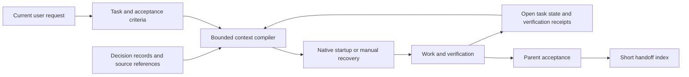

# Implementation plan: verifiable continuity with bounded overhead

Date: 2026-11-05. Status: proposed; implementation has not started.
Baseline and findings: [report.md](report.md), [results.json](results.json).

## Goal and scope

Make every supported session able to establish what it is doing, which decisions
apply, what is unfinished, and which evidence is still valid after compaction,
restart or model switch. Reduce redundant reads and checks without losing
qualifications or weakening verification. Do this by extending the existing
stdlib-only compiler, Memory Bank, adapters and validators.

The first release should support one coordinator and reliable manual/native
recovery. A multi-client fleet, remote synchronization, embeddings and automatic
deployment are optional later projects. Pacing remains OFF unless separately
activated under existing policy. No numerical token-saving promise is made.

## Acceptance targets

These are proposed engineering gates, not measurements already achieved.

| Area | Baseline | Required outcome |
|---|---|---|
| Decision preservation | Prose decision can miss projection | Every required fixture decision is restored with its qualifiers and source ID |
| Interrupted work | One latest-task handoff | Every open fixture task survives restart; stale attempts cannot mark it accepted |
| Handoff integrity | Missing/prose/multiline state can silently pass | Fresh startup distinguished from resume; malformed/incomplete resume has an explicit status |
| Lifecycle health | Unexpected exception can be silent | Every tested failure has a bounded diagnostic; manual fallback is verified |
| Context size | 8,511-char aggregate; 1,381-char projection | Preserve 9,500 hard cap; target <=8,500 aggregate and <=6,000 task projection |
| Archive growth | Fifty decisions exceed projection cap | A synthetic 1,000-record archive remains retrievable while required task context fits or explicitly refuses |
| Test orchestration | Full gate repeated by `--compat` | Each expensive suite runs once per CI matrix job without lost checks |
| Native compatibility | Structural fixtures; no live receipts | Dated receipts for each claimed client/surface; unsupported cases explicitly labeled |
| Efficiency | No paired provider evidence | Pilot measures complete accepted tasks; savings remain unclaimed until supported |
| Authorization | Written policy and advisory controls | Stored decisions cannot create spend, publication or external-action authority |

"100%" applies only to deterministic invariants in a declared fixture set.
It is not a statistical guarantee about future model behavior. Recovery testing
must include both successful restoration and refusal to invent missing facts.

## Architecture and authority

Keep four kinds of state separate:

1. **Canonical guidance:** existing `AGENTS.md` and lazy-loaded workflows.
2. **Reviewed project memory:** non-confidential typed records and product
   criteria, suitable for that project's repository classification.
3. **Private runtime state:** task attempts, client receipts, account/quota
   observations, source feedback and any authorization provenance outside Git.
4. **Context projection:** a disposable view with provenance and hashes; never
   the only copy of a decision or an authorization mechanism.

Prefer a configurable private state directory keyed by project identity, with
atomic task documents for the single-coordinator stage. Keep a small reviewed
portable summary in Memory Bank. The source IDs in exports must not reveal
private paths or account identifiers. Do not copy confidential source material
into this template, including ignored files: it has public history.

The handoff becomes a pointer to the selected task and the open-work inventory.
A revision check rejects stale writes. File replacement must be atomic; competing
coordinators require a real lock or a transactional store before support can be
claimed. Do not describe atomic rename alone as a lock. SQLite is reserved for
the optional concurrent-runtime phase, and is not shared over a network drive.

## Phase 1 — Correct the contract and remove repeated validation

Priority P1/P2. Size S. No prerequisite. Addresses F02, F08, F09.

Work:

- Correct compiler order/body-retention documentation and the false equivalence
  between Git tracking and local durability. Mark historical decisions as
  superseded where they contradict active policy, preserving their history.
- Replace universal cache/effort/tool-loading claims with dated, scoped guidance.
  Keep one canonical explanation and short links from other files.
- Describe pre-compaction behavior accurately; remove claims of guaranteed
  memory flush before implementing verified delivery.
- Remove the duplicate full CI invocation, preserving standalone `--compat`;
  alternatively split named check groups if that is smaller after inspection.
  Keep each negative fixture and each OS/Python matrix entry.
- Correct any misleading short command references affected by the changes.

Affected: `docs/context-compiler.md`, `docs/context-hygiene.md`,
`docs/context-memory-bridges.md`, `docs/hooks.md`, `memory-bank/decisions.md`,
`.github/workflows/validate.yml`; `scripts/check-template.py` only if check
selection is actually separated.

Verification: compare the union of old/new check groups; instrument temporary
fixtures to confirm each expensive group executes once; run full validation
once and targeted compatibility checks only if their implementation changed.
Document cold/warm CI timing later, without estimating provider savings from it.
Rollback: revert the isolated documentation/CI commit; no data migration.

## Phase 2 — Make restoration failure visible and validate handoff

Priority P1. Size M. Depends on phase 1. Addresses F02, F03, F05.

Work:

- Define a versioned handoff/receipt schema with task ID, revision, project and
  worktree identity, base revision, dirty-input fingerprints, next action,
  required decision IDs, open work, evidence references and timestamp.
- Support explicit fresh-project mode. On resume, missing fields and unsupported
  YAML structures produce precise diagnostics. Choose strict minimal frontmatter
  or JSON deliberately; do not introduce an unneeded YAML dependency.
- Apply bounded reads and path checks to handoff as well as records. Treat
  source paths/contents as data. Preserve legacy handoffs with a read-only
  compatibility path and a previewable migration; no silent rewriting.
- Add a small `scripts/continuity.py doctor` interface (proposed command),
  reusing `ctx.py` and boundary inspection. Report `ready`, `degraded` or
  `blocked`, with reasons and a concrete recovery action.
- Separate a compiler-generated receipt from proof that the client consumed
  it. Client version, orchestration surface, hook availability, observed model
  and observed effort must be known or explicitly `unknown`; requested config
  values do not count as observed runtime values.
- Replace swallowed exceptions with redacted diagnostic codes. Use a tested
  lifecycle event for context delivery. Keep milestone writes as the main
  checkpoint mechanism; pre-compaction cannot be the only persistence point.

Affected: `scripts/ctx.py`, `scripts/hooks/session-context.py`,
`scripts/verify-context.py`, `scripts/hooks/verify-fixtures.py`, new continuity
schema/CLI/tests, `workflows/handoff.md`, hook docs and relevant adapters.

Verification: missing/empty/prose-only handoff; multiline blocker; stale branch;
changed dirty file; BOM; oversized source; invalid encoding; missing compiler;
permission error; failed hook; no hook runtime; fresh project. No malformed
resume may be presented as healthy. A mismatch must preserve existing files.
Test manual recovery without a native hook. Do not launch paid session tests
as an accidental side effect of `doctor`.

Rollback: versioned legacy reader and manual FAST_INIT remain usable. Disable
only the new lifecycle integration if a client regression occurs.

## Phase 3 — Connect decisions to task-specific context

Priority P1/P2. Size M. Depends on phase 2. Addresses F01, F06, F07.

Work:

- Extend records with explicit scope, source reference, category, status and
  supersession. Distinguish decision/preference/example/hypothesis; do not let
  a quoted instruction inside source material become an executable instruction.
- Provide an atomic write-and-read-back path with stable IDs. Its receipt names
  the record, stored revision and inclusion status. Update all memory-write
  workflows and skill mirrors to route through that contract.
- Retain exact source feedback privately when needed, with reviewed summaries
  and qualifications in project memory. An approved example stays an example.
  Confidential decisions in derived projects use private storage and must not
  be exported back into the public template.
- Partition global mandatory constraints, explicitly required task records and
  lazy historical records. Build selection from explicit IDs/tags, without an
  LLM call in a hook. Do not use recency alone to discard old valid constraints.
- Extend compiler receipts with included/omitted IDs, reasons, source revisions
  and archive pointers. Preserve deterministic ordering and stable prefixes.
- Archive completed prose history behind compact indexes; retain active risks,
  unresolved actions and source provenance.

Affected: `scripts/ctx.py`, continuity CLI, record schema and fixtures,
`workflows/update-memory-bank.md`, `workflows/handoff.md`,
`.agents/skills/docs-memory-maintainer/SKILL.md`, `.claude/commands/save-context.md`,
`memory-bank/00-index.md`, benchmark scenarios and generated mirrors.

Verification: create 1,000 synthetic records with superseded and cross-topic
entries. Restore all required IDs and exact qualifiers, fit the task projection
within its cap, retrieve any archived source by ID, reject an over-budget
mandatory set, and detect a source revision mismatch. Confirm that a decision
written by the supported workflow is available after a clean process restart.
Inspect the union of root instructions and injected context, not only blob size.

Rollback: retain old records/readers and export before migration. No destructive
archive cleanup. Candidate projection can be disabled independently.

## Phase 4 — Preserve unfinished work and evidence across sessions

Priority P1. Size M/L. Depends on phases 2-3. Addresses F04, F11, F12.

Work:

- Add a small task manifest: ID, goal, acceptance target, scope, dependencies,
  owner, revision, attempt, status, next step, required records, evidence and
  unresolved items. Keep task status separate from deployment status.
- Start with one coordinator. Use `queued -> running -> review -> accepted`,
  with explicit blocked/cancelled states. A worker result is not acceptance.
  Store the frozen task/result envelopes and artifact hashes using existing
  schemas instead of inventing another delegation message format.
- Validate acceptance evidence against the relevant input/artifact fingerprint;
  a new commit alone need not invalidate an unrelated check. A changed relevant
  file does invalidate its old success receipt, including uncommitted changes.
- Turn `handoff.md` into a bounded current-task pointer plus open-task IDs.
  Recovery reconciles task inventory, files, native workers and incomplete
  attempts before resuming dependent work.
- Capture scoped authorization references as provenance only. Revocation,
  expiration, account, action and scope must be represented. Never replay
  a past publication/spend approval as current permission or treat agent mail
  as human authorization. Do not repeatedly ask for already valid authorization
  within the current authorized task.
- Add optional per-session/task correlation to write metadata; exclude command
  bodies, contents, raw transcript and machine-specific identifiers from exports.

Affected: new task/evidence schemas and stdlib state helper, continuity CLI,
`workflows/handoff.md`, `docs/subagent-contract.md`,
`workflows/self-evaluate.md`, `scripts/hooks/log-writes.py`, integration fixtures.

Verification: interrupt before write, after write, during review and before
acceptance. Restart and recover the same open inventory. Reject stale/duplicate
results and circular dependencies. Two lead processes must either serialize
through an actual lock/revision transaction or explicitly refuse concurrent
ownership. Test that switching between tasks does not erase earlier work.
Current worktree data must survive every failure path.

Rollback: readable export of task states and manual handoff; stop task writers
before migration or rollback. No deletion of unaccepted work.

## Phase 5 — Add cost awareness without enabling quota consumption

Priority P2. Size M. Depends on phase 4. Addresses F07, F10.

Work:

- Reuse existing sanitized pacing telemetry and completion-package estimates.
  Add per-task elapsed time, tool calls, restore reads, review rounds, test runs
  and measured token fields where available. Separate main and worker totals
  and define aggregation to avoid counting reasoning/cache tokens twice.
- Record measurement source, timestamp, scope and gaps. Shared-account quota
  deltas cannot be attributed to one task when other sessions are active.
- Offer ordinary-task checkpoints for lack of progress, repeated failed
  hypotheses, projected overrun and approaching context pressure. These remain
  useful with no subscription telemetry.
- Keep user hard limits hard. Finish only inside existing authorization;
  the article's discretionary quota overrun is not a default rule.
- Use milestone checkpointing even without occupancy data. Where telemetry
  exists, retain configurable early-drain/wrap-up thresholds and measure them;
  do not hardcode 270k tokens or claim 80% is a universal reliability boundary.
- Detect actual client/model/effort when exposed, reporting unknown otherwise.
  Do not edit global model defaults or silently replace user-selected models.

Affected: `scripts/usage-pacing.py`, its tests, `scripts/benchmark-context.py`,
continuity/task receipt schemas, `docs/usage-pacing.md`, routing/testing docs.

Verification: missing/stale data, reset boundaries, concurrent account usage,
model change, absent fields on older clients, explicit hard limit, double-count
prevention, no-progress loop and successful early completion. Existing pacing
activation and OFF-by-default tests must remain unchanged in meaning.

Rollback: disable optional measurement collection; task continuity still works.
Hard provider spending enforcement remains an external capability.

## Phase 6 — Prove native recovery and measure benefit

Priority P1 release gate. Size M/L. Depends on phases 2-5.

Work:

- Create portable scenario fixtures for restart, compaction, model switch,
  interrupted review, superseded decision, corrupted state and lost result.
  Add explicit expected facts and forbidden inferences. Include repeated
  deterministic restore cycles; they do not simulate model reasoning quality.
- Run a small disposable-project pilot on each client/surface actually used.
  Start with Claude and Codex manual recovery, then opt into verified lifecycle
  hooks. Cover Gemini/Antigravity separately; their payloads are not interchangeable.
- Record client/version/platform/orchestration, observed inputs, actions and
  outputs. Keep `synthetic`, `documented` and `live verified` labels distinct.
  A CLI version does not certify the app's orchestration mode.
- Compare baseline/candidate on matched tasks and model/effort settings, alternating
  order and separating cold/warm cache runs. Begin with five representative task
  types and three paired runs each where budget permits; label this a pilot,
  not a robust statistical guarantee. Report median/range and failed tasks.
- Reuse the existing >=10% total-token reduction policy for optional efficiency
  adoption, with no correctness/privacy regression. Reliability fixes may still
  be accepted without token savings; report that tradeoff explicitly.

Affected: `benchmarks/context/scenarios.json`, benchmark harness, native-smoke
guide, `schemas/adapter-capabilities.json`, test documentation and sanitized
evidence reports. Raw runs stay outside the public repository.

Verification: a second session reconstructs required decisions, exact next step
and all open work from persisted state; it recognizes intentionally missing
evidence. Unsupported hook modes pass through the manual path without claiming
native loading. No benchmark uses unrelated private project data.

Rollback: retain measured baseline/manual path. Native activation and any
additional paid API expenditure require their own applicable authorization.

## Phase 7 — Close feedback and product acceptance loops

Priority P2/P3. Size S/M. Depends on phase 4; can follow the core release.

Work:

- Add an optional short intake step for ambiguous product work: user outcome,
  non-goals, constraints, approved examples, and two or three concrete options.
  Use existing project-planner/spec workflows; avoid a mandatory interview for
  every small task.
- Give feedback and retrospective actions IDs, owners, closure evidence and
  links to tasks/decisions. Start each retrospective with prior unresolved actions.
  Separate process failures from product/user outcomes.
- Add application-specific acceptance matrices for UI/API/MCP routes where those
  routes exist, plus environment, rollout/rollback and authorized scope.
- Add optional visual standards to `assets/`/project docs only for UI projects.
  Preserve approved layout decisions; test reference fidelity and accessibility.
- Review instruction growth: turn repeated failures into a test or scoped
  workflow before adding another permanent root prohibition.

Affected: `memory-bank/productContext.md`, planning/spec/self-evaluation
workflows, optional retrospective workflow/skill, deployment template and
generator manifests as needed.

Verification: a feedback item traces to its exact decision, task and acceptance
evidence; an example does not become a requirement; a previously rejected idea
does not reappear as new work without a changed premise. Reports stay short.
Rollback: optional workflows can be removed without affecting core recovery.

## Phase 8 — Optional concurrent runtime and cross-machine operation

Priority P3, deferred until a measured need. Size L. Depends on phases 4 and 6.

Reuse the existing subagent-runtime and local-mail proposals. Implement one
native dispatch adapter, atomic task/path claims, attempts, lease fencing,
heartbeats, late-result rejection and acknowledged cancellation. Do not reassign
write ownership until the old process is stopped or isolated. Keep one worker
and two open tasks initially; demonstrate two independent accepted tasks before
raising limits. Mail read/handled receipts are transport state, not acceptance.

For multiple computers, separately choose an authorized private transport,
conflict model, access policy and recovery procedure. Local Git commits and
SQLite WAL do not provide that transport. Never use this public template as
the synchronization store for confidential application decisions. External
test servers require measured resource contention and their own data boundary.

Verification: two competing coordinators, crash/restart, stale lease, delayed
result, failed cancellation, branch conflict, quota reset and disconnected
machine. Prove zero unauthorized duplicate claims in the controlled fixture
set. This is explicitly not included in the minimum continuity release.

## Packaging, rollout and maintenance

For every phase: freeze acceptance criteria, make a small local commit after
checks, update `activeContext.md`/`handoff.md`, and regenerate only affected
mirrors with `scripts/gen-adapters.py`. Add new required files to validator,
new-project and preservation-upgrade manifests deliberately. Do not overwrite
derived-project memory, active client settings or private runtime state.

Before release, test fresh generation and preservation upgrade on disposable
projects containing custom instructions, old handoffs and dirty application
files. Run the full gate once, plus targeted checks justified by changed code.
Use one isolated read-only review for material contract/runtime changes, with
at most two repair cycles. Native smoke receipts are a separate release gate.
Publication remains a separate explicitly authorized action.

## Recommended sequence and effort assumptions

Start with phases 1-3: remove contradictions and duplicate work, expose missing
state, then connect decision writes to restoration. Add phase 4 before relying
on multiple workstreams. Phase 5 supplies measurements; phase 6 determines what
can truthfully be advertised. Phases 7-8 are optional extensions.

S means roughly one focused implementation/review package; M means two or three;
L means several and carries native-client or concurrency uncertainty. These are
relative planning estimates, not delivery dates, token budgets or subscription
cost forecasts. Measure actual effort after phase 2 before fixing a calendar.

Stop expanding the harness if a phase adds more recurring overhead than useful
recovery value. The release criterion is a verified useful task reaching
acceptance with recoverable state, not number of agents, rules, compactions or
tokens consumed.
